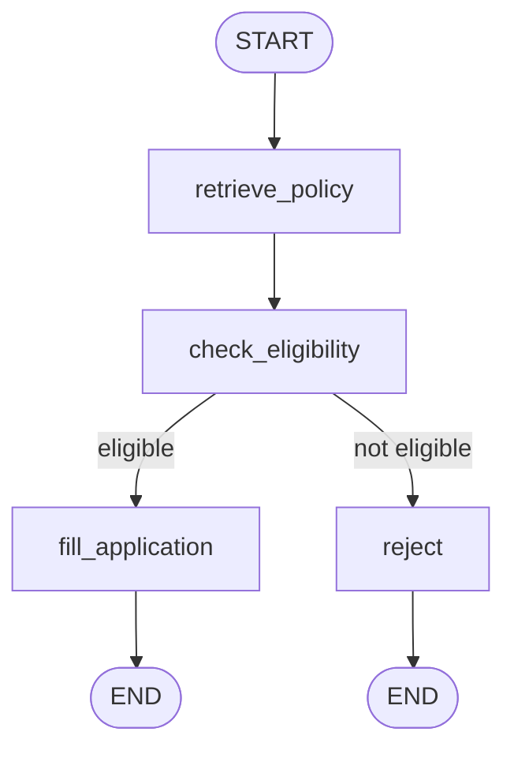
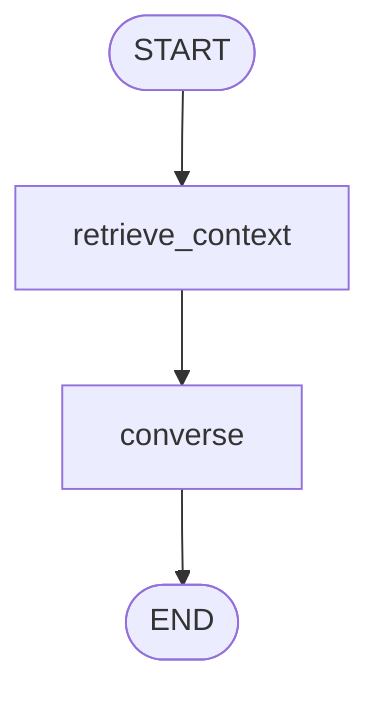

# Agent Orchestration — Code 19 HR Leave Assistant

This document describes the tools/components built for this system and how they're wired
together with **LangGraph**. It covers two separate graphs: the **Leave Request Pipeline**
(runs once per submission, whether triggered directly or from chat) and the **Chat Agent**
(runs once per conversational turn).

## Design principle: deterministic gate, LLM narration

Every leave decision in this system is made by a plain Python rules engine
(`app/policy_rules.py::evaluate_request`), **not** by an LLM. The LLM's job everywhere in this
codebase is retrieval-grounded explanation, drafting, and conversation — never the eligible/
not-eligible call itself. This was a deliberate choice: leave balances, notice periods, and
day caps are hard numeric rules an LLM can misread or hallucinate, so the boolean that actually
gates approval has to be auditable code, not a model's opinion. Every prompt that touches a
decision explicitly tells the model this ("a deterministic policy engine has already decided...
you must NOT change that verdict").

---

## Tools / components inventory

These are the building blocks both graphs are assembled from. None of them are LangChain
"tool-calling" tools in the ReAct sense — this system doesn't use a tool-calling loop. Instead
each is a plain Python module that a graph **node** calls directly.

| Component | File | What it does |
|---|---|---|
| Ollama Cloud chat client | `app/llm/client.py` | Talks to Ollama Cloud (`https://ollama.com`) for the chat model. Wraps every structured call with a JSON-only system-prompt instruction + defensive parsing (strip markdown fences, extract the `{...}` span, one corrective retry) — Ollama Cloud silently ignores the native `format=<json_schema>` grammar-constrained decoding that local Ollama models honor, so this is a deliberate workaround, not an oversight. |
| Local embedding client | `app/llm/client.py` | Talks to a local `ollama serve` daemon for `/api/embed` — Ollama Cloud doesn't serve embeddings at all, regardless of key/model. |
| RAG ingest | `app/rag/ingest.py` | Chunks `data/policy_source.md` into one chunk per lettered policy section (A–L), embeds each with the local embedding model, stores in a persistent Chroma collection. Rebuildable (`force=True` drops and recreates the collection — needed whenever the embedding model changes, since vector dimensions differ). |
| RAG retriever | `app/rag/retriever.py` | Embeds a query string, does a similarity search against the Chroma collection, returns the top-k policy chunks with section/title/text/distance. |
| Deterministic rules engine | `app/policy_rules.py` | `evaluate_request(...)` — the single source of truth for eligibility. Encodes every numeric rule from the policy PDF (CL 2-day cap, SL certificate threshold, EL notice period + senior-approval threshold, PL/ML gender + notice-week + child-count rules, LWP discretionary). Returns `{eligible, reasons, needs_senior_approval, requested_days, notice_working_days}`. |
| Balance calculator | `app/balances.py` | Computes `entitlement - used - pending` per leave type from the `LeaveRequest` table (year-scoped for CL/SL/EL, all-time for PL/ML child counts). This is what both the eligibility node and the chat agent's context are grounded in — never guessed by the model. |
| Holiday calendar | `app/holidays.py` | Structured (non-LLM) data: resolves real dates for the policy's fixed-date festival holidays plus the Friday/Saturday weekly off, and explicitly flags the moon-sighting/government-declared holidays as "not fixed yet" rather than letting the model invent a date. Fed into the chat agent's prompt so leave-date suggestions are grounded in facts, not guesses. |
| Leave pipeline graph | `app/agents/graph.py` + `nodes.py` + `state.py` + `schemas.py` | See below. |
| Chat agent graph | `app/agents/chat_graph.py` + `chat_nodes.py` + `chat_state.py` + `chat_schemas.py` | See below. |

---

## Graph 1 — Leave Request Pipeline

**File:** `app/agents/graph.py` · **State:** `LeaveAgentState` (`app/agents/state.py`) · compiled
once via `get_leave_request_graph()` (`@lru_cache`), invoked fresh per request (no checkpointer —
all state is supplied by the caller and consumed in one `.invoke()`).



| Node | Function | Tool(s) used | Reads from state | Writes to state |
|---|---|---|---|---|
| `retrieve_policy` | `retrieve_policy_node` | RAG retriever | `leave_type` | `retrieved_chunks`, `agent_trace` |
| `check_eligibility` | `eligibility_agent_node` | Rules engine (`evaluate_request`) **+** LLM structured call (`EligibilityExplanation`) | `leave_type`, dates, balance, gender, retrieved chunks | `eligible`, `rule_reasons`, `needs_senior_approval`, `requested_days`, `llm_summary`, `policy_citations`, `agent_trace` |
| `fill_application` *(conditional)* | `application_filler_node` | LLM structured call (`ApplicationDraft`) | employee/manager info, dates, reason, `llm_summary` | `filled_application_text`, `final_status="pending_manager"`, `agent_trace` |
| `reject` *(conditional)* | `rejection_node` | — (pure state update) | — | `final_status="rejected_by_agent"`, `agent_trace` |

**Routing:** `route_after_eligibility(state)` returns `"fill_application"` or `"reject"` based purely
on `state["eligible"]` — the boolean the rules engine computed, not anything the LLM decided.

**Structured output schemas** (`app/agents/schemas.py`):
- `EligibilityExplanation { summary, cited_sections }` — the model narrates the *already-decided*
  verdict, grounded in the retrieved policy excerpts, and must cite section letters.
- `ApplicationDraft { application_text }` — a formal leave-application letter, only ever generated
  on the `fill_application` branch (i.e., only for requests the rules engine already approved).

**Who calls this graph:** `run_leave_pipeline()` in `app/routers/leave.py` — builds the initial
state (employee info + balance fetched from `app/balances.py`), invokes the graph, persists the
result as a `LeaveRequest` row. This function is shared by two callers:
1. `POST /leave/requests` — direct REST submission.
2. The chat router's submit step (see below) — so a request that started as a conversation goes
   through the *exact same* eligibility/drafting logic as a direct API call.

---

## Graph 2 — Chat Agent

**File:** `app/agents/chat_graph.py` · **State:** `ChatAgentState` (`app/agents/chat_state.py`) ·
compiled once via `get_chat_graph()`, invoked fresh per chat message. Multi-turn memory is **not**
handled by a LangGraph checkpointer — conversation history and the in-progress draft are persisted
in SQL (`ChatMessage`, `ChatDraft` tables) and passed into the graph explicitly on every call.



| Node | Function | Tool(s) used | Reads from state | Writes to state |
|---|---|---|---|---|
| `retrieve_context` | `retrieve_context_node` | RAG retriever | `user_message` | `retrieved_chunks` |
| `converse` | `converse_node` | LLM structured multi-turn call (`ChatTurnResponse`) + pure-Python slot merge | `employee_context`, `balance_context`, `holiday_context`, `history`, `collected_slots`, `retrieved_chunks`, `user_message` | `reply`, `updated_slots`, `missing_fields`, `ready_to_submit` |

This graph deliberately does **not** decide whether to submit a leave request — it only decides
what to *say* and what *fields* have been mentioned so far. That separation matters: the model can
say "sure, let's submit that!" and be wrong (e.g. it forgot to notice a missing `reason`), so a
second, non-LLM check gates the actual handoff:

```python
# app/agents/chat_nodes.py
missing = missing_required_fields(updated_slots)   # pure Python, not the model's opinion
ready = bool(response.ready_to_submit and not missing)
```

`missing_required_fields()` enforces: `leave_type`, `start_date`, `end_date` (or just `start_date`
for a half-day), `reason` always; `medical_certificate_confirmed` additionally for Maternity Leave.

**Structured output schema** (`app/agents/chat_schemas.py`):
- `ChatTurnResponse { reply, leave_type?, start_date?, end_date?, is_half_day?, reason?, medical_certificate_confirmed?, child_dob?, ready_to_submit }`
  — every slot field is optional and only set by the model when the employee actually mentioned it
  that turn; a Python loop in `converse_node` merges non-null fields into the cumulative
  `collected_slots` dict so the draft survives across turns without the model needing to repeat
  itself.

**Who calls this graph:** `POST /chat/{employee_id}/messages` in `app/routers/chat.py`.

---

## End-to-end workflows

### A. Direct API leave request (`POST /leave/requests`)

```
Employee (authenticated) → POST /leave/requests
  → run_leave_pipeline()
      → get_leave_balance()                         [balances.py]
      → get_leave_request_graph().invoke(state)      [Graph 1]
      → persist LeaveRequest row (status = pending_manager | rejected_by_agent)
  → response includes agent_trace, policy_citations, filled_application_text (if eligible)
```

### B. Conversational leave request (`POST /chat/{employee_id}/messages`)

```
Employee message → POST /chat/{id}/messages
  → load last 16 ChatMessage rows as history, load ChatDraft.slots
  → build context: employee info, live balances, holiday calendar
  → get_chat_graph().invoke(state)                   [Graph 2]
  → if ready_to_submit:
        build LeaveRequestCreate from updated_slots
        run_leave_pipeline()                         [same as workflow A]
        clear the draft; append the outcome to the reply
    else:
        persist updated_slots as the new draft (conversation continues)
  → persist the user + assistant ChatMessage rows (linked to the LeaveRequest if one was created)
```

The two workflows converge on the same `run_leave_pipeline()` call — chat is a different *front
door* to the same deterministic decision pipeline, not a parallel/duplicate implementation of it.

### C. HR decision (`POST /hr/requests/{id}/decision`)

Not agent-driven — a plain authenticated endpoint. HR/manager approval or rejection of a
`pending_manager` request is a human decision; the agents' job ends once a request reaches the
queue. Approval increments `paternity_used`/`maternity_used` where applicable (for the 2-child
caps enforced by the rules engine on future requests).

---

## Why two separate graphs instead of one

The leave pipeline is a short, one-shot, side-effecting workflow (retrieve → decide → draft/
reject → persist) with no need for conversational memory. The chat agent is the opposite: pure
conversation state, no side effects of its own. Merging them into one graph would mean either the
chat graph re-running eligibility/drafting logic on every turn (wasteful, and risks the LLM being
asked to reason about submission on turns where nothing is ready yet), or the leave pipeline
carrying unused conversational fields. Keeping them separate and composing them at the router
layer (`run_leave_pipeline()` called from both) gives one authoritative implementation of "decide
and draft" while letting each graph's state schema stay minimal and honest about what it actually
needs.
